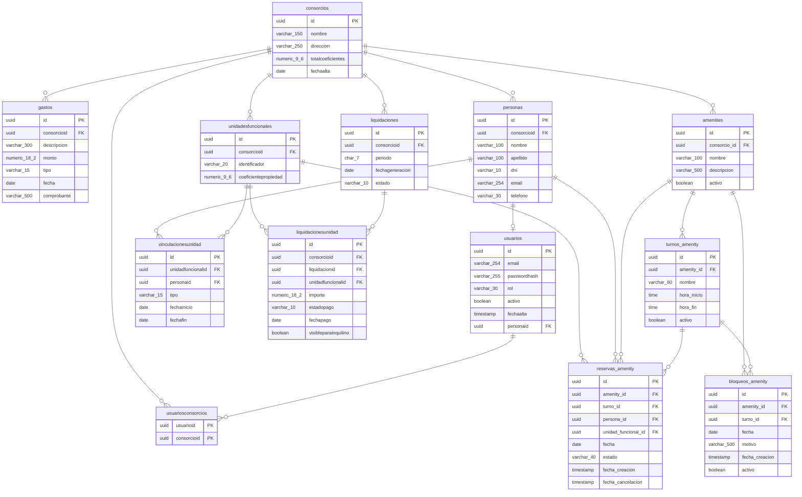

# Diagrama entidad-relación

**Proyecto:** Sistema de Administración de Consorcios  
**Trabajo Final Integrador — Grupo 128**  
**Entrega:** Entrega final  
**Base de datos:** PostgreSQL · esquema `dbo`

El diagrama representa las trece tablas de la base: las nueve del núcleo administrativo (`schema-consorcios.sql`) y las cuatro del módulo de Amenities (`amenities.sql`). Los nombres de tabla se muestran en minúsculas, como los almacena PostgreSQL. Incluye campos, tipos de datos, claves y relaciones. Los índices y las claves compuestas se detallan debajo.

## 1. Diagrama

El mismo diagrama está disponible como imagen: [PNG](diagrama-bd-completo.png) y [SVG](diagrama-bd-completo.svg); el código fuente Mermaid está en [diagrama-bd-completo.mmd](diagrama-bd-completo.mmd).

## 2. Cómo leer el diagrama

- **PK:** clave primaria, identifica cada registro.
- **FK:** clave foránea, relaciona tablas.
- **UK:** valor único. Las combinaciones de campos únicos se indican en la sección siguiente.
- **Opcional:** el campo admite `NULL`. Los demás campos son obligatorios.
- **`||`:** exactamente uno; **`o|` / `|o`:** cero o uno; **`o{`:** cero o muchos.
- Las líneas discontinuas indican relaciones no identificadoras: cada tabla tiene su propia clave primaria `Id`.

Una persona puede tener varias vinculaciones con unidades, pero como máximo una cuenta de usuario. Un usuario puede no tener persona. Un administrador de consorcio puede administrar varios consorcios, uno o ninguno (tabla `UsuariosConsorcios`); solo se cargan filas para usuarios con rol `ADMINISTRADOR_CONSORCIO`, regla que valida `UsuarioService` porque un `CHECK` no puede consultar otra tabla.

## 3. Claves únicas y relaciones compuestas

Además de las claves primarias, el esquema define las siguientes restricciones de unicidad:

| Tabla | Campos únicos |
|---|---|
| Personas | `(ConsorcioId, Dni)` |
| Usuarios | `Email` |
| Usuarios | `PersonaId`, cuando no es `NULL` |
| UnidadesFuncionales | `(ConsorcioId, Identificador)` |
| UnidadesFuncionales | `(Id, ConsorcioId)` |
| Liquidaciones | `(ConsorcioId, Periodo)` |
| Liquidaciones | `(Id, ConsorcioId)` |
| LiquidacionesUnidad | `(LiquidacionId, UnidadFuncionalId)` |
| amenities | `(consorcio_id, nombre)` |
| turnos_amenity | `(amenity_id, nombre)` |

En `LiquidacionesUnidad`, las relaciones usan **dos campos en conjunto**:

| Campos de origen | Tabla y campos de destino |
|---|---|
| `(LiquidacionId, ConsorcioId)` | `Liquidaciones (Id, ConsorcioId)` |
| `(UnidadFuncionalId, ConsorcioId)` | `UnidadesFuncionales (Id, ConsorcioId)` |

Estas claves garantizan que la liquidación y la unidad pertenezcan al mismo consorcio. No existe una clave foránea independiente desde `LiquidacionesUnidad.ConsorcioId` hacia `Consorcios`.

## 4. Índices principales

Las claves primarias y las restricciones `UNIQUE` generan sus propios índices. Además, el SQL declara los siguientes:

| Índice | Tabla | Campos y condición |
|---|---|---|
| UX_Usuarios_PersonaId | Usuarios | Único sobre `PersonaId`, donde `PersonaId IS NOT NULL`. |
| IX_UsuariosConsorcios_ConsorcioId | UsuariosConsorcios | `ConsorcioId`. |
| IX_Vinc_UF | VinculacionesUnidad | `(UnidadFuncionalId, Tipo)`. |
| IX_Vinc_Persona | VinculacionesUnidad | `PersonaId`. |
| IX_Gastos_Consorcio_Fecha | Gastos | `(ConsorcioId, Fecha DESC)`. |
| IX_LiqUF_UF_Estado | LiquidacionesUnidad | `(UnidadFuncionalId, EstadoPago)`. |
| IX_LiqUF_Pendientes | LiquidacionesUnidad | `ConsorcioId`, donde `EstadoPago = 'PENDIENTE'`. |
| idx_reserva_amenity_fecha | reservas_amenity | `(amenity_id, fecha)`. |
| idx_bloqueo_amenity_fecha | bloqueos_amenity | `(amenity_id, fecha)`. |
| uk_reserva_activa_amenity_turno | reservas_amenity | Único sobre `(amenity_id, turno_id, fecha)`, donde `estado = 'ACTIVA'`: un turno no admite dos reservas activas el mismo día. |
| uk_bloqueo_activo_amenity_turno | bloqueos_amenity | Único sobre `(amenity_id, turno_id, fecha)`, donde `activo = true`. |

## 5. Restricciones principales del esquema

- **Usuarios:** roles `SUPERADMINISTRADOR`, `ADMINISTRADOR_CONSORCIO`, `PROPIETARIO` o `INQUILINO`.
- **Consorcios:** total de coeficientes igual a 100.
- **Unidades:** coeficiente mayor que cero y menor o igual a 100. Un *constraint trigger* diferido (`TR_UF_SumaCoeficientes`) verifica al confirmar la transacción que, si el consorcio tiene unidades, la suma de sus coeficientes sea 100, con una tolerancia de ±0.0001 por redondeo (ver sección 9 de `Entrega_1.md`). Un `CHECK` no alcanza porque solo evalúa una fila; el trigger permite cargar todas las unidades en una misma transacción.
- **Vinculaciones:** tipo `PROPIETARIO` o `INQUILINO`; la fecha de fin, si existe, no puede ser anterior a la de inicio. Al eliminar una unidad, se eliminan sus vinculaciones.
- **Gastos:** monto mayor que cero y tipo `ORDINARIO` o `EXTRAORDINARIO`.
- **Liquidaciones:** estado `ABIERTA` o `CERRADA`.
- **Liquidaciones por unidad:** importe mayor o igual a cero y estado de pago `PENDIENTE` o `PAGADO`.
- **Amenities:** nombre único dentro del consorcio. **Turnos:** nombre único dentro del amenity y hora de fin posterior a la de inicio. **Reservas:** estado `ACTIVA` o `CANCELADA_POR_USUARIO`. **Bloqueos:** motivo obligatorio y activos o inactivos.

## 6. Relación entre gastos y liquidaciones

No hay clave foránea entre `Gastos` y `Liquidaciones`: la liquidación de un período se calcula tomando los gastos del consorcio cuya `Gastos.Fecha` cae dentro del mes indicado por `Liquidaciones.Periodo` (`YYYY-MM`). Ver las reglas completas en la sección 9 de `Entrega_1.md`.

Este documento representa el esquema actual; las reglas de negocio que no están expresadas en el SQL deberán implementarse en la aplicación.
