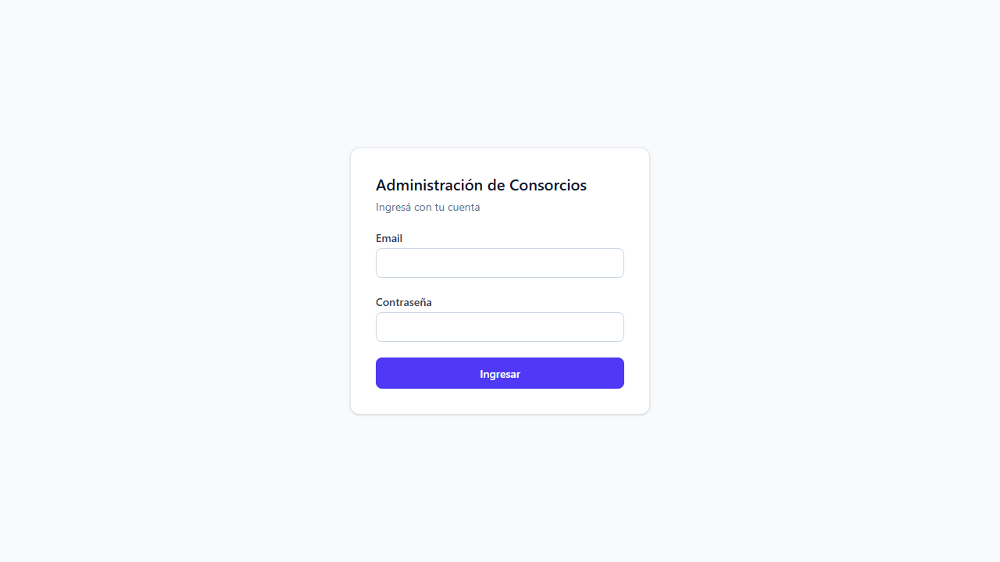
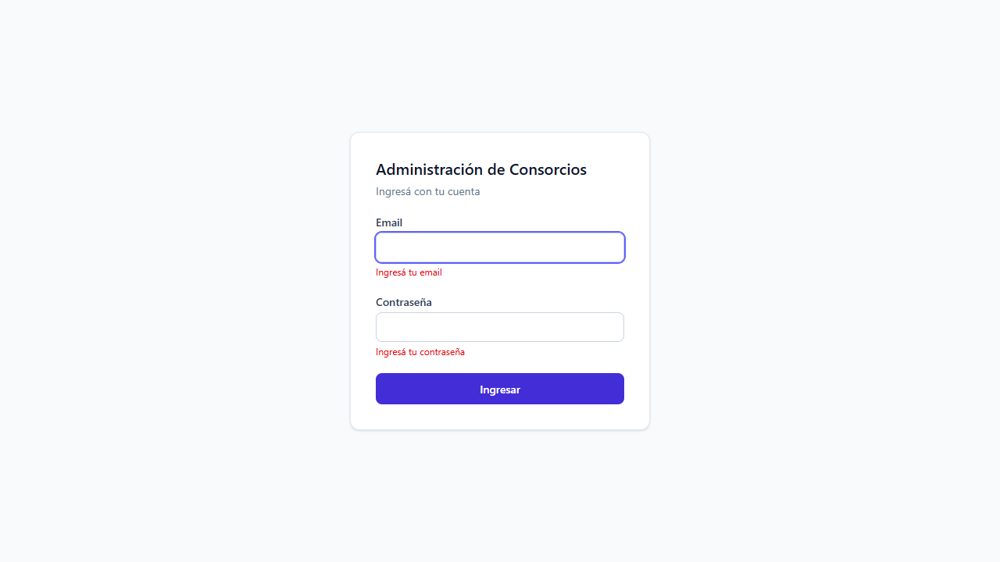

# Frontend: pantallas y contrato con la API

**Proyecto:** Sistema de Administración de Consorcios — Grupo 128

Documento de seguimiento del frontend (React, TypeScript, Vite, Tailwind, TanStack Query). Describe las pantallas implementadas, cómo se relacionan con el backend y qué falta. Las pantallas de gestión se probaron en el navegador contra la base de Supabase con usuarios de prueba (ver [instalacion.md](instalacion.md)).

## 1. Cómo levantarlo

```powershell
cd frontend
copy .env.example .env      # ajustar VITE_API_URL al puerto donde corra el backend (ej. 9090 si PORT=9090)
npm install
npm run dev                 # http://localhost:5173
```

## 2. Pantallas implementadas

Todas, salvo el login, son rutas protegidas (`RutaProtegida`): sin sesión redirigen a `/login`. El menú lateral muestra solo lo que corresponde al rol.

| Ruta | Pantalla | Quién la usa | Qué hace |
|---|---|---|---|
| `/login` | Login | Todos | Email y contraseña; muestra el estado de la conexión con el servidor y la base. |
| `/` | Tablero | Todos | Resumen: cantidad de consorcios y de unidades del consorcio activo. |
| `/consorcios` | Consorcios | Superadmin, administrador | Alta y edición de consorcios (el alta es solo del superadmin). Un administrador sin consorcios asignados ve un aviso. |
| `/unidades` | Unidades | Superadmin, administrador | Edición del conjunto de unidades y sus coeficientes con una barra que suma 100. |
| `/personas` | Personas | Superadmin, administrador | Personas del consorcio activo: alta, edición, búsqueda, exportación a Excel y CSV. DNI único por consorcio. |
| `/vinculaciones` | Vinculaciones | Superadmin, administrador | Asocia personas a una unidad como propietarias o inquilinas, con fecha de inicio y fin. |
| `/gastos` | Gastos | Superadmin, administrador | Alta, edición y baja de gastos ordinarios y extraordinarios. |
| `/liquidaciones` | Liquidaciones | Superadmin, administrador | Genera la liquidación mensual, la cierra y exporta a Excel. |
| `/pagos` | Pagos | Superadmin, administrador | Marca la liquidación de cada unidad como pagada o revierte el pago. |
| `/usuarios` | Usuarios | Solo superadmin | Alta de cuentas, activar/desactivar y asignar a cada administrador **uno, varios o ningún consorcio**. |
| `/cuenta` | Cambiar contraseña | Todos | Cambio de la contraseña propia. |

### Consorcio activo

Los administradores pueden tener varios consorcios. El selector de la cabecera aparece cuando hay más de uno, y el consorcio elegido se recuerda en el navegador. Las pantallas de unidades, personas, gastos, liquidaciones y pagos trabajan sobre el consorcio activo. Un administrador sin consorcios ve "No hay un consorcio para mostrar".

### Estados de carga

Las pantallas muestran `Cargando…` con un indicador mientras llega la respuesta, sin contadores ni tablas vacías. Los datos se consideran frescos durante 30 segundos, por lo que volver a una pantalla ya visitada es instantáneo.

### Capturas

Las capturas de `capturas/` corresponden al login y al tablero de la primera versión.

| Login | Validación de campos |
|---|---|
|  |  |

## 3. Contrato con el backend

Tipos en `frontend/src/types/index.ts`; llamadas en `frontend/src/services/`. Todas las rutas, salvo login y health, exigen `Authorization: Bearer <token>` (`401` sin token o con token inválido, `403` si el rol o el consorcio no corresponden).

| Método y ruta | Rol | Descripción |
|---|---|---|
| `POST /api/auth/login` | Público | `{ email, password }` → `{ token, email, rol }`. |
| `GET /api/health` | Público | Estado del backend y de la base. |
| `PUT /api/cuenta/password` | Todos | Cambia la contraseña propia. |
| `GET/POST /api/consorcios`, `GET/PUT /api/consorcios/{id}` | Superadmin, administrador | El superadmin ve todos; el administrador solo los que tiene asignados. |
| `GET/PUT /api/consorcios/{id}/unidades` | Superadmin, administrador | Lista y reemplaza el conjunto de unidades (la suma de coeficientes debe ser 100). |
| `/api/consorcios/{id}/personas` | Superadmin, administrador | `POST`, `GET`, `GET /{id}`, `PUT /{id}`. |
| `/api/consorcios/{id}/unidades/{unidadId}/vinculaciones` | Superadmin, administrador | `POST`, `GET` y `PATCH /{id}/finalizar`. |
| `/api/consorcios/{id}/gastos` | Superadmin, administrador | `POST`, `GET`, `PUT /{gastoId}`, `DELETE /{gastoId}`. |
| `/api/consorcios/{id}/liquidaciones` | Superadmin, administrador | `POST`, `GET`, `GET /{id}/unidades`, `PATCH /{id}/cerrar`. |
| `/api/consorcios/{id}/pagos` | Superadmin, administrador | `GET`, `PATCH /{detalleId}/pagar`, `PATCH /{detalleId}/revertir`. |
| `/api/usuarios` | Solo superadmin | `GET`, `GET /{id}`, `POST`, `PATCH /{id}` (estado y `consorcioIds`). |
| `GET /api/mi-cuenta/liquidaciones` | Propietario, inquilino | Liquidaciones de las unidades del usuario. **Sin pantalla todavía.** |

`rol` es uno de: `SUPERADMINISTRADOR`, `ADMINISTRADOR_CONSORCIO`, `PROPIETARIO`, `INQUILINO`. El token JWT vence a los 60 minutos por defecto (`JWT_EXPIRATION_MINUTES`).

## 4. Estructura relevante

```text
frontend/src/
├── components/   Layout, RutaProtegida, ConsorcioActivo, Modal, Estados
├── pages/        Una página por pantalla de la tabla anterior
├── services/     api.ts (fetch con JWT), auth, consorcios, personas, gastos, pagos,
│                 csv.ts y excel.ts (exportaciones), health
└── types/        Contrato con la API
```

## 5. Pendiente y limitaciones

- **Consulta del propietario e inquilino:** el backend ya expone `GET /api/mi-cuenta/liquidaciones`, pero falta la pantalla.
- No hay "olvidé mi contraseña" ni registro público de usuarios: las cuentas las crea el superadmin.
- No hay borrado de consorcios ni de personas.
- Las capturas del tablero y del login son de la primera versión; faltan capturas de las pantallas de gestión.
- Los datos de prueba (`@demo.test`) son solo para desarrollo y deben borrarse antes de una entrega real.
