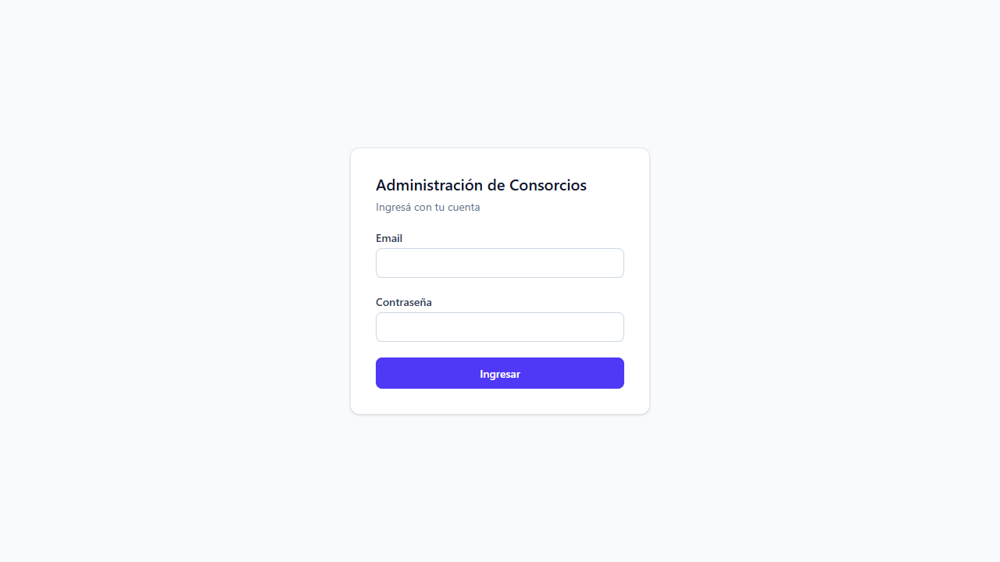
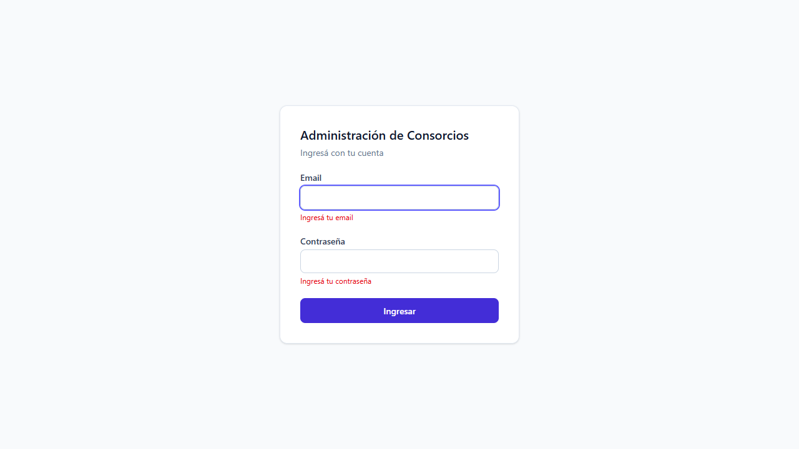
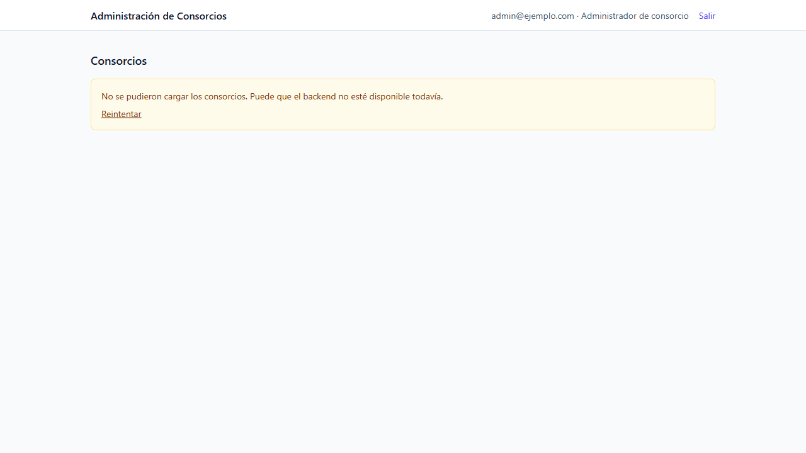

# Frontend: avance de pantallas

**Proyecto:** Sistema de Administración de Consorcios — Grupo 128

Documento de trabajo con las pantallas del frontend implementadas hasta el momento. El backend ya expone el login, el listado de consorcios y la verificación de conexión (ver sección 3), y la conexión a la base de Supabase está verificada. **El flujo completo de login contra la base queda por confirmar** una vez cargado el primer superadministrador (ver [instalacion.md](instalacion.md)). Las capturas de abajo se tomaron antes, con la interfaz sin conexión.

## 1. Cómo levantarlo

```powershell
cd frontend
copy .env.example .env      # ajustar VITE_API_URL al puerto donde corra el backend (ej. 9090 si PORT=9090)
npm install
npm run dev                 # http://localhost:5173
```

## 2. Pantallas

### 2.1 Login (`/login`)

Archivo: `frontend/src/pages/LoginPage.tsx`

- Formulario de email y contraseña (React Hook Form).
- Valida que ambos campos no estén vacíos.
- Envía `POST /api/auth/login`; si responde bien, guarda el token y redirige al dashboard.
- Si falla, muestra un mensaje de error en el formulario.
- Debajo del botón muestra el estado de la conexión (consulta `GET /api/health` al abrir la pantalla): verde si el servidor y la base responden, amarillo si el servidor está activo pero sin base, rojo si no se puede contactar al servidor. Código en `frontend/src/services/health.ts`.

| Estado inicial | Validación de campos |
|---|---|
|  |  |

### 2.2 Dashboard (`/`)

Archivo: `frontend/src/pages/DashboardPage.tsx`

- Ruta protegida (`RutaProtegida`): sin token redirige a `/login`.
- Cabecera con el email, el rol del usuario y el botón "Salir".
- Listado de consorcios obtenido con `GET /api/consorcios`, con estados de carga, lista vacía y error con "Reintentar".



La captura se tomó con una sesión simulada en el navegador (sin autenticación real) y sin backend: por eso se ve el aviso de error al cargar los consorcios, que es el comportamiento esperado en ese caso.

## 3. Contrato esperado del backend

Definido en `frontend/src/types/index.ts` e **implementado en el backend** (controladores `AuthController`, `ConsorcioController` y `HealthController`).

| Método y ruta | Cuerpo / respuesta |
|---|---|
| `POST /api/auth/login` | Recibe `{ email, password }`. Devuelve `{ token, email, rol }`. `401` si las credenciales son inválidas, `400` si falta algún campo. |
| `GET /api/consorcios` | Devuelve una lista de `{ id, nombre, direccion, fechaAlta }`. Requiere `Authorization: Bearer <token>`; sin token o con token inválido responde `401`. El superadministrador ve todos los consorcios, el administrador de consorcio el suyo y propietarios e inquilinos una lista vacía (su consulta por unidades es un módulo posterior). |
| `GET /api/health` | Público. `200` con `{ backend, baseDeDatos }` en `UP`; `503` con `baseDeDatos: DOWN` si el backend no llega a la base. |

`rol` es uno de: `SUPERADMINISTRADOR`, `ADMINISTRADOR_CONSORCIO`, `PROPIETARIO`, `INQUILINO`.

El token JWT vence a los 60 minutos por defecto (`JWT_EXPIRATION_MINUTES`).

## 4. Estructura relevante

```text
frontend/src/
├── components/RutaProtegida.tsx   Redirige a /login si no hay sesión
├── pages/LoginPage.tsx
├── pages/DashboardPage.tsx
├── services/api.ts                fetch con el token JWT
├── services/auth.ts               login, logout y sesión actual
├── services/health.ts             estado de la conexión con el backend y la base
└── types/index.ts                 enums y contrato con la API
```

## 5. Pendiente

- Probar el flujo completo de login y dashboard con un usuario real cargado en la base (ver "Primer usuario" en [instalacion.md](instalacion.md)) y actualizar las capturas con el backend conectado.
- Pantallas siguientes del MVP: unidades funcionales, personas y vinculaciones, gastos, liquidaciones y pagos.
- Mostrar menús y acciones según el rol (la seguridad real se aplica en el backend).
